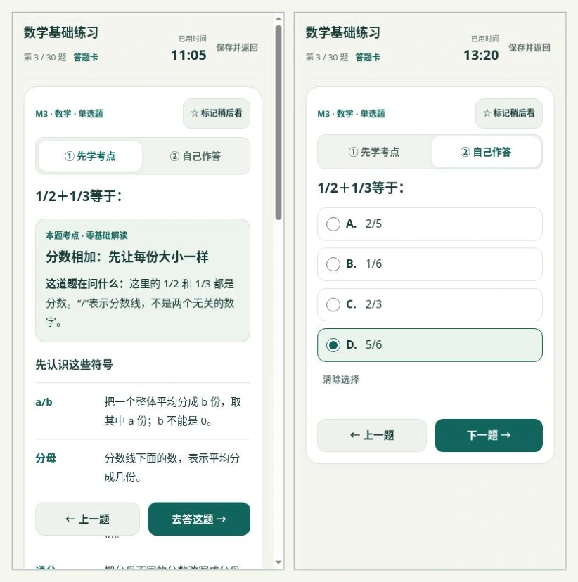

# 数学零基础考点解读 · 2026-10-12

## 学习内容

- M1—M30 全部配有：题意翻译、符号释义、基础概念、另一道例题的三步演示、需要记忆的规律、易错提醒。
- 分数配等分图；正弦、余弦、正切配同一个角的认边图。图形有文本替代和说明。
- 解读数据与原题答案分开；原题、选项、答案、评分、备份版本未修改。
- 不声称原创基础题是真实历年试题，解读也不用于预测出题频率。

## 使用行为

未答的数学题默认进入“先学考点”。可以直接点“自己作答”，也可以读完后点“去答这题”；无需勾选或通过测验才能答题。作答视图收起长解读，可以随时回看。

当前浏览器保存每题的学习/作答视图。切换、标记、清除答案和重新打开页面不意外切换视图；已选答案保持。旧草稿和 JSON 备份仍用原有版本读取；导入备份时按已答/未答决定初始视图。

数学题在数学专项、按天练习、综合练习中均显示解读。语文和英语沿用原有答题流程。最后一题在学习视图显示“去答这题”，作答视图才显示“检查并交卷”。

## 检查记录

- `node --check exam/app.mjs`：通过。
- `node tests/math-lessons.test.mjs`：30 个完整解读、不同例题、科目限定、原题数学答案独立核验通过。
- `node tests/exam.test.mjs`：99 题评分、主观题分离、完整 TXT 导出、JSON 往返及无效备份拒绝通过。
- `node tests/answer-card.test.mjs`：题型分组与题目跳转通过。
- 浏览器逐题打开 M1—M30，检查全部知识栏目；分数与三角形图解渲染通过。
- 集合题选择答案 → 回看考点 → 返回作答 → 标记 → 清除 → 重新选择：视图及答案行为正确。
- 重新加载新版 → 恢复练习：题目位置、学习视图、已选答案和标记保留。
- 集合、分数正确作答后交卷：2/30 分，2 题正确、0 题错误、28 题未答；逐题订正共 30 题。
- 第一天综合练习：语文和英语无数学控件，数学题仍默认显示完整解读。

## 响应式布局

通过线上 `tests/responsive.html` 对实际页面检查。它改变页面宽高，不模拟手机操作系统或微信内核。

| 画面 | 学习/作答 | 结果 |
|---|---|---|
| 320×640、375×640 | 集合题作答 | 无横向溢出；完整四个选项在导航上方；前后题按钮可见 |
| 390×800、430×800 | 集合、分数学习与作答 | 无横向溢出；学习按钮保持可见；作答选项及导航可见 |
| 768×1024 | 学习与作答 | 无横向溢出，答题卡可收起，导航可见 |
| 1024×800、1280×800 | 学习与作答 | 无横向溢出，答题卡显示；长内容通过页面滚动阅读 |

检查到的可见交互控件均至少 44px。手机导航按钮高度为 48px；长学习页导航离画面底部 48px。小屏作答页单独收紧间距，不缩小知识页正文字号。

真实微信内核、iOS/Android 字体放大与系统键盘未在本次浏览器环境中实机验证。

页面资源版本：`20261012.5`。
