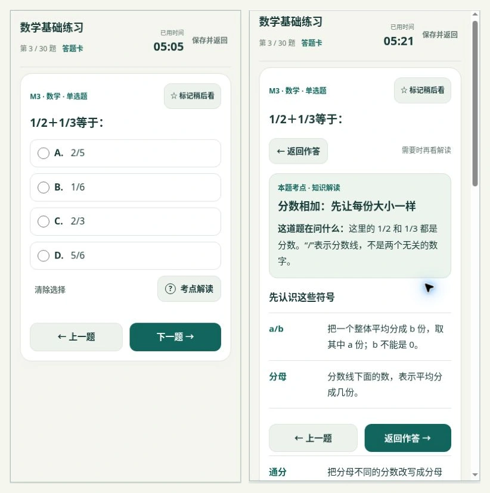

# 数学考点解读 · 按需帮助 · 2026-10-12

页面资源版本：`20261012.6`。

## 默认顺序

所有数学题先显示题目和选项。取消“先学考点 / 自己作答”的步骤栏，将“考点解读”作为选项下方的可选帮助。用户主动点击后才进入知识页；题干保持可见，上方和手机导航处均提供“返回作答”。

新题、上一题、答题卡跳题、恢复草稿、重新打开页面均默认进入作答页。解读是否打开仅作为当前页面的临时状态，不保存为每题的默认视图。旧版 `mathStages` 状态不再读取，原有题目位置、答案、标记、用时和历史保留。

全部 30 道数学题仍保留符号释义、题意解读、基础概念、不同例题的步骤、记忆规律与易错提醒，分数和三角函数图解保留。题库、答案、评分和 JSON 备份版本未改动。

## 验证

- `node --check exam/app.mjs`：通过。
- `tests/exam.test.mjs`、`tests/math-lessons.test.mjs`、`tests/answer-card.test.mjs`：通过。
- 浏览器逐题打开 M1—M30：全部为作答视图，均显示 4 个单选项，解读保持关闭；末题直接显示“检查并交卷”。
- 旧版先选择答案并标记、停在学习页 → 打开新版并恢复：进入作答页，原答案和标记保留。
- 主动打开解读 → 返回同一题：答案保留；在学习页点上一题，或之后再进入这题，均显示作答页。
- 在解读页刷新 → 继续答题：进入作答页，解读关闭。
- 320×640、375×640、390×800、768×1024、1280×800：无横向溢出，检查到的可见控件至少 44px，分数题四个选项在导航上方，下一题可见。
- 页面未记录来自应用的运行错误。

响应式检查使用实际页面在指定宽高内渲染，不模拟手机操作系统或微信内核。本次未进行微信内核或系统键盘实机验证。

