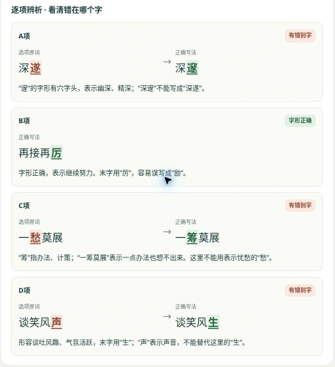

# C2 字形题核验 · 2026-10-12

本次核验范围为用户截图中的 C2。检查截图、线上题库字面、评分、辞典字形和订正页，不据此声称全部题目内容已重新审查。

| 选项原词 | 结论 | 正确写法 |
|---|---|---|
| A 深遂 | “遂”应为“邃” | 深邃 |
| B 再接再厉 | 字形正确 | 再接再厉 |
| C 一愁莫展 | “愁”应为“筹” | 一筹莫展 |
| D 谈笑风声 | “声”应为“生” | 谈笑风生 |

截图 A 字面及题库均为“深遂”。B 是唯一无错别字的选项，原参考答案 B 与 `correct: 1` 正确。原解析只列出正确词语，没有逐项指出差别，容易看混。

## 修改

C2 的解释补充逐项说明，交卷后的订正页以原词和正确写法对照，放大并突出错字、正字，附简短记忆解释。题干、选项顺序、正确答案及全部其他题目内容未改。原备份版本保留。

## 依据

使用公开辞典核验标准词形，网站解析为自行编写的简体中文说明：

- 深邃：https://dict.concised.moe.edu.tw/dictView.jsp?ID=34666&la=0&powerMode=0
- 邃的字形：https://dict.variants.moe.edu.tw/dictView.jsp?ID=73010&q=1
- 再接再厲：https://dict.concised.moe.edu.tw/dictView.jsp?ID=37060&la=1&powerMode=0
- 一籌莫展：https://dict.revised.moe.edu.tw/dictView.jsp?ID=149626&la=0&powerMode=0
- 談笑風生：https://dict.concised.moe.edu.tw/dictView.jsp?ID=10479&la=0&powerMode=0

## 验证

- JavaScript 语法检查及 `tests/exam.test.mjs` 通过。
- 逐项计分检查：仅 B 得分，其他 3 个选项不得分。
- 修改前后比较 99 道题的题干、选项、参考答案、正确索引均相同；仅 C2 的解析与新增字形说明变化。
- 浏览器选择 A 并交卷：C2 显示错误；选择 B 并交卷：C2 显示正确。
- 订正页出现 4 项对照；重新打开已保存的 A 答卷，仍判错且显示新解析。
- 320×640、390×800、768×1024、1280×800：无横向溢出、无可见控件低于 44px；页面未记录来自应用的运行错误。

响应式检查为指定宽高下的实际页面渲染，不代表微信内核实机测试。

资源版本：`20261012.7`。
